<div align="center">



# ManaApp

**Помощник стримера для Windows — и интерактивная игра «Пробуждение Дракона», где чат сражается со стримером.**

[](https://github.com/zeroyuranchik-stack/ManaApp/releases/latest)
[](https://github.com/zeroyuranchik-stack/ManaApp/releases)
[](#-установка)
[](#-что-умеет)

<a href="https://github.com/zeroyuranchik-stack/ManaApp/releases/latest">
  
</a>

</div>

---

## ✨ Что умеет

<table>
<tr>
<td width="50%" valign="top">

### 🟣 Twitch вживую
- Чат, рейды, подписки, биты, награды за баллы — в реальном времени (EventSub)
- Опросы и клипы прямо из программы
- Бот пишет в чат: с антифлудом и защитой от дублей
- Лог и статистика каждого стрима

</td>
<td width="50%" valign="top">

### 🐉 Игра «Пробуждение Дракона»
- Стример — Дракон-босс, чат — армия героев
- Накопление опыта → бой → магазин, по кругу
- Криты, атаки Дракона, штраф за тишину
- 6 фаз эволюции модели и предметы из Warudo

</td>
</tr>
<tr>
<td width="50%" valign="top">

### 🎥 Оверлей для OBS
- Своя страница для Browser Source
- Работает только на этом компьютере и по ключу
- Тестовая сцена одной кнопкой

</td>
<td width="50%" valign="top">

### 🧪 Без живого стрима
- Симулятор чата: сообщения, рейды, обрыв связи
- Стресс-режим до 5000 сообщений в секунду
- Удобно настраивать и проверять до эфира

</td>
</tr>
<tr>
<td width="50%" valign="top">

### 🎭 Warudo
- Мост к сцене Warudo по WebSocket
- Предметы магазина надеваются на модель
- Трансформация сохраняется одной кнопкой

</td>
<td width="50%" valign="top">

### 🔄 Сама обновляется
- Проверяет новые версии здесь, на GitHub
- Скачивает, сверяет SHA-256, сохраняет настройки
- Во время эфира не мешает

</td>
</tr>
</table>

> 🐉 Игра «Пробуждение Дракона» и драконья тема — эксклюзив владельца канала. Остальные стримеры получают те же инструменты помощника в нейтральном оформлении.

## 📦 Установка

1. Откройте **[последний релиз](https://github.com/zeroyuranchik-stack/ManaApp/releases/latest)** и скачайте `ManaApp-vX.Y.Z-windows-x64.zip`.
2. Распакуйте в любую папку, например `C:\ManaApp`.
3. Запустите **`ManaApp.exe`** — откроется мастер первого запуска.

**Нужно:** Windows 10 или 11 (64-bit). **По желанию:** [OBS Studio](https://obsproject.com) для оверлея, [Warudo](https://warudo.app) для модели.

<details>
<summary><b>Подключить Twitch</b></summary>

1. Создайте приложение на [dev.twitch.tv/console/apps](https://dev.twitch.tv/console/apps) — тип **Public**, Redirect URL `https://localhost:17563/`.
2. В программе: **Модули → Твич → Настройки** → вставьте Client ID и логин канала → «Сохранить».
3. «Получить код активации» → подтвердите в браузере под аккаунтом стримера.

Пароль от Twitch программа не видит: вход подтверждается на сайте Twitch, токен хранится зашифрованным.

</details>

<details>
<summary><b>Добавить оверлей в OBS</b></summary>

1. **Модули → Кор → Инфо** → «Включить оверлей» → «Скопировать».
2. В OBS: **Источник → Браузер** → вставьте адрес, размер 1920 × 1080.
3. «Тестовая сцена» — если надпись появилась в OBS, всё работает.

</details>

## 🔄 Обновления

Программа сама проверяет этот репозиторий — при запуске и раз в сутки, во время эфира не предлагает.
Установить: **Модули → Кор → Проверка → «Установить»**. Архив проверяется по SHA-256, настройки и данные (`configs`, `data`, `logs`) не трогаются, при ошибке — откат на прежнюю версию.

<details>
<summary><b>Проверить архив вручную</b></summary>

```powershell
Get-FileHash .\ManaApp-vX.Y.Z-windows-x64.zip -Algorithm SHA256
```

Хэш должен совпасть со строкой `SHA-256` в описании релиза и с файлом `.sha256` рядом с архивом.

</details>

## 🔒 Приватность

- Всё работает на вашем компьютере: настройки, логи и токены лежат рядом с программой.
- Токен Twitch хранится зашифрованным (AES-256).
- Оверлей доступен только с этого компьютера и только по секретному ключу.
- Анонимная статистика — только с вашего согласия; отказ означает, что не собирается ничего.

## 🗺 Дорожная карта

| | Этап | Что появится |
|:-:|---|---|
| ✅ | **0.10** | Фундамент: Twitch, игра, Warudo, оверлей, симулятор, обновления |
| 🔜 | **11** | Telegram-бот и рандаун стрима с напоминаниями |
| ⏳ | **12** | Живая книга стрима, титры, цитаты, мини-игры со ставками |
| ⏳ | **13** | Боссфайт 2.0: ярость, способности Дракона, итоги боя |
| ⏳ | **14** | Таро стрима, профили зрителей, драконий ник |
| ⏳ | **15–16** | Планер, аналитика, Кодекс, достижения |
| ⏳ | **17** | Кокпит «одно окно» и новый интерфейс |

## 💬 Нашли ошибку?

Откройте [issue](https://github.com/zeroyuranchik-stack/ManaApp/issues) и приложите `logs\app.log` из папки программы.

---

<div align="center">
<sub>Готовые сборки ManaApp. Исходный код в этом репозитории не публикуется.</sub>
</div>
