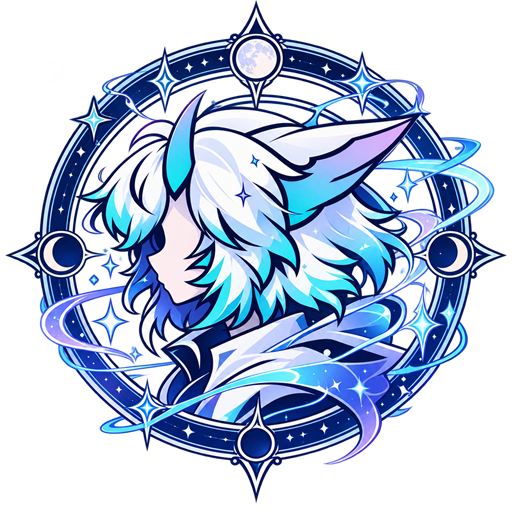

<div align="center">



# ManaApp

**Помощник стримера для Windows: подготовка к эфиру, единый чат Twitch и YouTube, донаты, оверлеи для OBS, Telegram-бот и мини-игры для чата — в одном окне.**

[](https://github.com/zeroyuranchik-stack/ManaApp/releases/latest)
[](https://github.com/zeroyuranchik-stack/ManaApp/releases)
[](#-установка)
[](#-что-внутри)
[](#-что-внутри)
[](#-что-внутри)

<a href="https://github.com/zeroyuranchik-stack/ManaApp/releases/latest">
  
</a>

</div>

---

## ✨ Коротко

> **0.20 — новый движок.** Программа переписана на Rust + Tauri: запускается быстрее, занимает меньше памяти, архив — около 9 МБ вместо прежних 100 с лишним. Настройки, входы и данные прошлых версий переносятся сами.

- 🧭 **Подготовка к стриму по шагам** — план эфира → название, категория и теги («Применить в Twitch») → чек-лист → кокпит.
- 🎛 **Кокпит** — одно окно на эфире: единый чат Twitch и YouTube, лента событий, опросы, прогнозы, рейды, клипы, маркеры, сцены OBS, шпаргалка и «Фокус-режим».
- ▶️ **YouTube** — чат канала рядом с Twitch, ответы, Super Chat и спонсорство, маркеры и главы для описания, модерация.
- 💜 **Донаты** — DonationAlerts и DonatePay: лента поддержки, плашки, виджет для OBS, уведомления в Telegram, донатон.
- 🎬 **OBS и оверлеи** — сцены, старт/стоп эфира и записи, каждый виджет отдельным источником, редактор сцен мышью.
- 📱 **Telegram-бот** — управление стримом с телефона, уведомления, пост после эфира.
- 📖 **Летопись** — книга стрима, благодарности, титры, цитаты и сайт-дневник.
- 🎲 **Мини-игры** — пять игр, которые бот сам ведёт в чате.
- ♡ **Личное** — задачи с напоминаниями, расписание стримов, самочувствие, банк идей.
- 🔄 **Сама обновляется** — с этой страницы, с проверкой архива и откатом при ошибке.

Всё работает на вашем компьютере, своего сервера у программы нет. Вход в Twitch — одной кнопкой.

## 🧭 Как устроена программа

Сверху три раздела: **Главная · Стрим · Настройки** (у роли «Пользователь» вместо «Стрима» — **Расписание**). Всё остальное — в меню **☰**, сгруппировано по смыслу: «Эфир», «Инструменты эфира», «Контент», «Я», «Подключения». Найти любой экран или настройку — **Ctrl+K**.

У каждого модуля только нужные вкладки: состояние, настройки и **«Проверка»** — кнопки, чтобы всё опробовать до эфира.

## 🧩 Что внутри

<details open>
<summary><b>🏠 Главная и оформление</b></summary>

- **Главная** — два экрана с прокруткой: приветствие, план на сегодня, что нового за эфир, поддержка за прошлый стрим, подсказки. Плитки ведут прямо к нужному месту.
- **Темы** «ночь / вечер / день» или по времени суток — с плавным переходом. По желанию — **погода за окном** на фоне, фоновая музыка и звуки интерфейса.
- **Масштаб** 90–125 %, полноэкранный режим **F11**.
- **Трей**: крестик прячет программу к часам — эфир и бот продолжают работать. Повторный запуск показывает уже открытое окно.

</details>

<details open>
<summary><b>🧭 Подготовка к стриму и кокпит</b></summary>

- **Подготовка по шагам**: выбрать план эфира → настроить эфир (название, категория с подсказками, теги) и применить в Twitch → пройти чек-лист → открыть кокпит.
- **Единый чат Twitch и YouTube**: значки платформ, фильтры «Все / События / Упоминания», поиск, кнопка «Ответить» и выбор, куда писать.
- **Лента событий**: фолловы, подписки, продления, подарочные сабы, биты, рейды, клипы, донаты.
- **Действия эфира**: опрос, прогноз, рейд, клип, маркер (на обеих платформах), сцены OBS.
- **Блоки кокпита** переставляются, «Фокус-режим» убирает всё лишнее. Шпаргалка — прямо в кокпите.
- **Горячие клавиши** переназначаются в настройках, конфликты подсвечиваются.

</details>

<details open>
<summary><b>🟣 Twitch</b></summary>

- **Вход в один шаг**: «Войти через Twitch» → подтвердите в браузере. Пароль программа не видит, токен хранится зашифрованным.
- **События в реальном времени (EventSub)**: чат, рейды, фолловы, подписки и подарки, биты, награды за баллы канала. Продления и подаренные сабы считаются правильно.
- **Опросы, прогнозы, клипы, рейды, награды** — прямо из программы.
- **Бот для чата** — от вашего аккаунта или от отдельного, настраивается пошагово; антифлуд и очередь.
- **Защита чата и модерация**: подозрительные ссылки, флуд, капс, повторы с понятной причиной; удалить, тайм-аут, бан в один клик, журнал модерации.
- **Статистика эфира**: онлайн сейчас / средний / максимум, сообщения, уникальные зрители, поддержка; лог каждого стрима.

</details>

<details open>
<summary><b>▶️ YouTube</b></summary>

- Вход через Google, активная трансляция и зрители.
- **Чат канала в кокпите** рядом с Twitch, ответы в чат.
- **Super Chat и спонсорство** (членство) — в ленте событий.
- **Маркеры и главы** для описания видео.
- **Модерация**: удалить, тайм-аут, бан.

<sub>Для YouTube нужен свой Client ID Google — пошаговая инструкция есть в самой программе.</sub>

</details>

<details open>
<summary><b>💜 Донаты</b></summary>

- **DonationAlerts и DonatePay**: лента поддержки, всплывающие плашки по важности.
- **Виджет для OBS** со своей ссылкой.
- Уведомления в Telegram и запись в Летопись.
- **Донатон**: обратный отсчёт, который растёт от донатов, подписок и наград.

</details>

<details open>
<summary><b>🎬 OBS, оверлеи, таймеры</b></summary>

- **OBS**: переключение сцен, старт и стоп трансляции и записи, предупреждение о пропуске кадров.
- **Оверлеи**: каждый виджет — отдельный источник «Браузер» в OBS со своей ссылкой; работают только на этом компьютере и по секретному ключу.
- **Редактор сцен**: виджеты перетаскиваются мышью, масштаб — ползунком.
- **Таймеры и счётчики** (секундомер, отсчёт, победы и поражения) — несколько штук, у каждого своя ссылка для OBS.

</details>

<details open>
<summary><b>📱 Telegram — стрим с телефона</b></summary>

- Свой бот (создаётся за минуту у @BotFather). Владелец бота — тот, кто первым написал ему `/start`, чужим он не подчиняется.
- **Команды**: `/status`, `/pause`, `/resume`, `/skip`, `/stop`, `/segment next|prev`, `/marker`, `/quote`, `/publish`, `/help`.
- **Уведомления по галочкам** для каждого чата: начало и конец стрима, поддержка, смена сегмента плана, ошибки программы.
- **Пост после эфира**: программа собирает черновик (длительность, сообщения, зрители, поддержка) и присылает вам — публикуется по `/publish` или кнопкой.
- Прокси (SOCKS5 / HTTP) указывается в настройках Telegram.

</details>

<details open>
<summary><b>🗓 План эфира и расписание</b></summary>

- **Сегменты** с длительностью, типом и заметкой; готовые шаблоны и свой редактор.
- **Плашки** «Сейчас: …» и «Дальше: …» с кнопками «Дальше» и «+5 мин»; предупреждение перед концом сегмента.
- **Напоминания**: вода, размяться, глаза, осанка — со своими интервалами.
- **Расписание стримов** по датам.

</details>

<details open>
<summary><b>📖 Летопись и 🎲 мини-игры</b></summary>

- **Книга стрима**: подписки, биты, рейды, донаты, победители мини-игр, лучшие цитаты; каждый эфир сохраняется отдельно.
- **Очередь «Поблагодарить»**, **титры в OBS**, **цитаты** (из чата или `/quote` из Telegram) с показом крупно на экране.
- **Дневник стрима** — отдельный сайт со своей ссылкой, добавляется в OBS как «Браузер».
- **Мини-игры**: викторина, «Угадай число», «Две правды», «Слово дня», «Перемешанное слово». Бот сам ведёт игру и считает ответы; запуск кнопкой или сегментом плана.
- **Вопросы лора**: банк вопросов и фактов, свои добавляются прямо в программе.

</details>

<details>
<summary><b>♡ Личное, уведомления, профиль</b></summary>

- **Личное**: задачи с напоминаниями, самочувствие, банк идей. Данные только на вашем компьютере.
- **Уведомления**: колокольчик с лентой, фильтры по категориям, тихие часы — важное не всплывает ночью, но остаётся в ленте.
- **Подключения**: все сервисы на одном экране, у каждого статус и одна кнопка «Подключить» или «Повторить».
- Мастер первого запуска: имя, роль, подключение Twitch, согласие на анонимную статистику (можно отказаться — тогда не собирается ничего).

</details>

## 📦 Установка

1. Откройте **[последний релиз](https://github.com/zeroyuranchik-stack/ManaApp/releases/latest)** и скачайте `ManaApp-vX.Y.Z-windows-x64.zip`.
2. До распаковки: правой кнопкой по zip → «Свойства» → «Разблокировать» → «ОК».
3. Распакуйте в свою папку, например `D:\ManaApp` (не в `Program Files` — программа хранит настройки рядом с собой).
4. Запустите **`ManaApp.exe`** — откроется мастер первого запуска.

**Нужно:** Windows 10 или 11 (64-bit) и WebView2 Runtime (в Windows 11 уже есть; если программа не открывается — установите «WebView2 Runtime» с сайта Microsoft).
**По желанию:** [OBS Studio](https://obsproject.com) для оверлеев и управления эфиром, Telegram для бота.

> ⚠️ Программа не подписана платным сертификатом, поэтому Windows может написать «Не удалось проверить издателя» или SmartScreen предупредит о запуске. Сверьте контрольную сумму (ниже) и нажмите «Подробнее» → «Выполнить в любом случае».

<details>
<summary><b>Уже стоит старая версия ManaApp</b></summary>

- **Обновить поверх**: в старой программе «Проверить обновления» → «Установить». Перед первым запуском 0.20 программа сама сделает резервную копию в `data\backups\before-0.20.0`, покажет окно «Что подхватилось» и предложит удалить файлы старого движка (только после подтверждения).
- **Распаковали в новую папку**: при первом запуске программа найдёт старую версию и предложит перенести настройки и данные. Старая папка не меняется.

</details>

<details>
<summary><b>Подключить Twitch</b></summary>

1. **Настройки → Подключения** (или прямо в мастере первого запуска) → кнопка у Twitch → «Войти через Twitch».
2. Код скопируется сам, страница Twitch откроется в браузере.
3. Вставьте код и подтвердите под аккаунтом стримера. Дальше программа подключается сама.

Если браузер не открылся — нажмите «Скопировать ссылку» и вставьте её в браузер.

</details>

<details>
<summary><b>Бот для чата от отдельного аккаунта</b></summary>

Мини-игры, план эфира и другие сообщения программы могут приходить от отдельного аккаунта-бота, а не от вашего. Пошаговая инструкция — **[Бот для чата](bot-guide.md)**.

</details>

<details>
<summary><b>Подключить Telegram-бота</b></summary>

1. В Telegram откройте **@BotFather** → `/newbot` → придумайте имя и логин (оканчивается на `_bot`) → скопируйте токен.
2. **☰ → Telegram** → вставьте токен → «Сохранить» → «Проверить».
3. Напишите своему боту `/start` в личку — вы станете его владельцем.
4. Чтобы посторонние не добавляли бота в группы: **@BotFather → /mybots → ваш бот → Bot Settings → Allow Groups? → Turn groups off**.
5. Для постов: **канал → Управление каналом → Администраторы → Добавить администратора** → найдите бота по логину → право «Публикация сообщений». Напишите в канале любой пост — канал появится в списке.

<sub>Из России Telegram и Discord могут работать только через прокси или VPN.</sub>

</details>

<details>
<summary><b>Подключить YouTube и донаты</b></summary>

- **YouTube**: **☰ → YouTube** → «Свой Client ID» — в программе есть пошаговая инструкция, как получить его в Google Cloud. Пока приложение Google в режиме тестирования, вход нужно повторять раз в 7 дней.
- **DonationAlerts**: **☰ → Донаты** → «Войти» и подтвердите в браузере.
- **DonatePay**: **☰ → Донаты** → вставьте свой API-ключ из кабинета DonatePay. Тестовая кнопка DonatePay в программу не приходит — проверяйте настоящим донатом.

</details>

<details>
<summary><b>Добавить оверлеи и дневник в OBS</b></summary>

1. **☰ → Оверлеи** → у нужного виджета «Скопировать ссылку». В OBS: Источник → Браузер → вставьте адрес, 1920 × 1080.
2. **Дневник**: **☰ → Летопись → Настройки** → включите дневник → «Скопировать ссылку» → тоже Источник → Браузер (размер любой, например 600 × 900).

</details>

## 🔄 Обновления

Программа сама проверяет этот репозиторий — при запуске и раз в сутки, во время эфира не мешает.
Установить: **Настройки → Обновления → «Обновить сейчас»**. Настройки и данные (`configs`, `data`, `logs`) не трогаются. Если установка не удалась, программа вернёт прежнюю версию и покажет причину.

<details>
<summary><b>Проверить архив вручную</b></summary>

```powershell
Get-FileHash .\ManaApp-vX.Y.Z-windows-x64.zip -Algorithm SHA256
```

Хэш должен совпасть со строкой `SHA-256` в описании релиза и с файлом `.sha256` рядом с архивом.

</details>

## 🔒 Приватность

- Всё работает на вашем компьютере: настройки, логи и данные лежат рядом с программой.
- Токены Twitch, YouTube, донат-сервисов и Telegram хранятся зашифрованными (AES-256).
- Оверлеи и дневник доступны только с этого компьютера и только по секретному ключу.
- Раздел «Личное» никуда не отправляется.
- Анонимная статистика — только с вашего согласия.

## 🗺 Дорожная карта

| | Версия / этап | Что появится |
|:-:|---|---|
| ✅ | **0.10–0.13** | Фундамент: Twitch (EventSub, опросы, клипы), оверлей для OBS, Telegram-бот, план эфира, живая книга, мини-игры, автообновление |
| ✅ | **0.14–0.15** | Новый интерфейс, поиск Ctrl+K, кокпит «Стрим», защита чата и модерация, модуль OBS |
| ✅ | **0.20** | Новый движок (Rust + Tauri), YouTube, донаты и донатон, единый чат, подготовка к стриму по шагам, редактор сцен, «Личное», расписание, трей |
| ⏳ | **Хвосты кокпита** | Карточка зрителя из чата, «на экран», подсказки на частые вопросы, клип «последние 60 секунд», сегмент плана → сцена OBS, редактор команд бота, эмоуты 7TV / BTTV / FFZ |
| ⏳ | **Планер** | Календарь недели и месяца, повторы, свободные окна и конфликты, планы стримов «план / факт», банк идей, отсчёт до эфира в OBS |
| ⏳ | **Зрители** | Профили зрителей: сколько стримов с вами, активность, история поддержки; награда «свой ник» за баллы канала с фильтром плохих ников |
| ⏳ | **Аналитика** | История эфиров, аудитория и возвращаемость, контент, поддержка, отчёты; опрос-итог после стрима |
| ⏳ | **Кодекс и достижения** | Своя wiki канала, дневник стримов, календарь памятных дат, достижения зрителей |
| ⏳ | **Ритуалы вокруг эфира** | Шаги после стрима: титры → дневник → опрос → пост → главы YouTube; авто-рейд друзьям; предложка в Telegram |
| ⏳ | **Дальше** | Цели сбора, привычки и цели стримера, справка в программе, библиотека записей YouTube, зал славы, другие соцсети |

## 💬 Нашли ошибку?

Откройте **[«Сообщить об ошибке»](https://github.com/zeroyuranchik-stack/ManaApp/issues/new/choose)** и приложите `logs\app.log` из папки программы (для обновления — ещё `logs\update.log`).

---

<div align="center">
<sub>Готовые сборки ManaApp. Исходный код в этом репозитории не публикуется.</sub>
</div>
